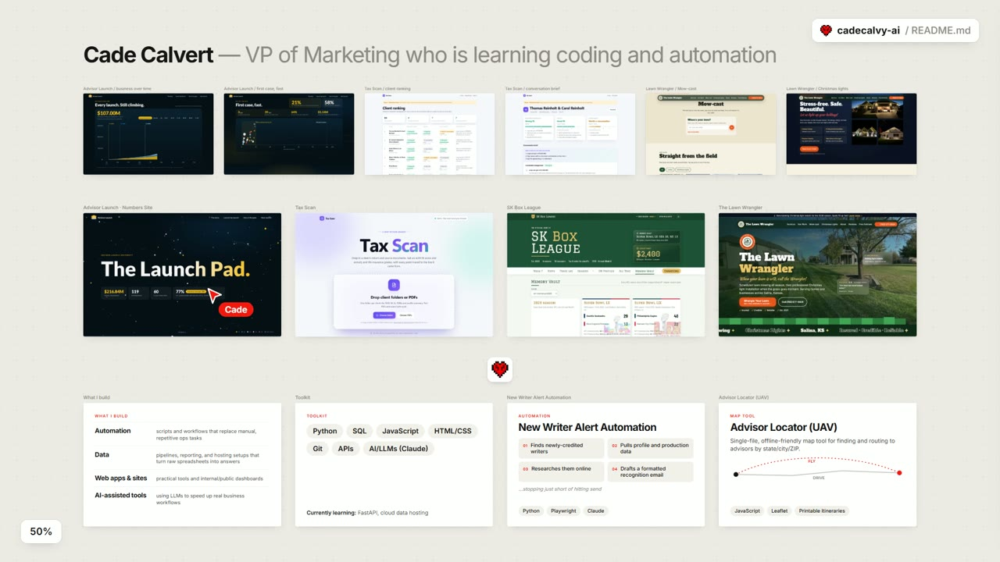

# Portfolio Video

A 20-second animated reel of my portfolio, built only from the portfolio's own material: my GitHub profile README, my avatar, and screenshots of the project sites it links to.

[](portfolio-video.mp4)

**[Watch the video (MP4, 1920×1080, 30 fps)](portfolio-video.mp4)**

## What's in it

| Time | Scene |
|---|---|
| 0–2.5s | A dot becomes my pixel-heart avatar |
| 2.5–4.5s | Zoom out to a canvas of everything I've built |
| 4.5–13s | A tour of four projects, each with a headline number and its tech |
| 13–15.5s | Two automation tools, with notes from the "At work" section of my README |
| 15.5–20s | Everything folds back into the heart, then the end card |

## How it works

- **`index.html`** is the whole film. Every element on screen is a pure function of time, so the page can play live in a browser or be stepped through one exact frame at a time.
- **`tools/render.mjs`** opens that page in headless Chrome, steps through all 600 frames, and pipes the screenshots into FFmpeg to make the MP4.
- **`tools/capture-sites.mjs`** takes the project screenshots in `assets/` from the live sites.
- **`tools/clean-avatar.py`** redraws my small GitHub avatar as crisp pixel art so it holds up full screen.

## Run it yourself

Open `index.html` in a browser to watch a live preview.

To re-render the MP4 you need Node.js, Google Chrome, and Python with `imageio-ffmpeg` (it supplies FFmpeg):

```
npm install
pip install imageio-ffmpeg
npm run render
```

To change the wording, timing or numbers, edit the data near the top of the script in `index.html` and render again.

`npm run capture` retakes the screenshots. The Tax Scan shots come from the fictional-client demo pages in the [tax-scan](https://github.com/cadecalvy-ai/tax-scan) repo; copy its `netlify_site/site` folder to `snapshots/taxscan` first.

## Tech

HTML/CSS · JavaScript · Puppeteer · FFmpeg · Python (Pillow)

The canvas-and-inspector format is inspired by the portfolio reels on [motionvideo.xyz](https://motionvideo.xyz).
